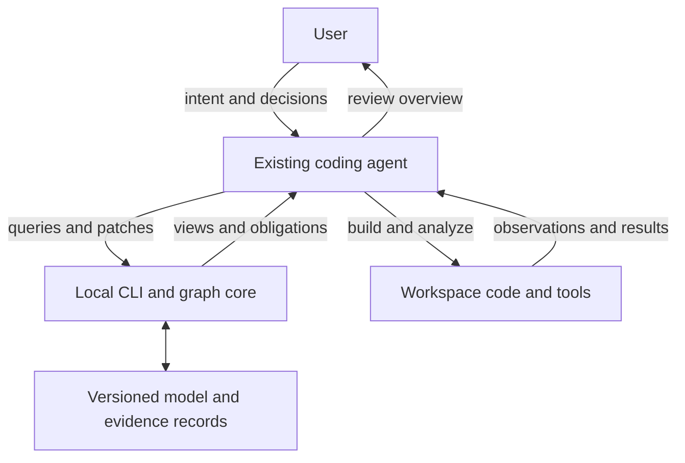

# Intent Graph: Vision and Architecture

**Working title:** Intent Graph  
**Document version:** 0.2 — design proposal and implementation sequence  
**Date:** 18 October 2026  
**Audience:** product builders, coding-agent users, and engineers implementing the tool

> A local, agent-operated system that maintains an annotated model of software intent, design, implementation mappings, and evidence. It closes the loop from human intent to implementation and back through explicit refinement, computable checks, and scoped review.

This document consolidates the design discussion into an implementable architecture. It is a vision and technical blueprint, not a claim that the software already exists. The product name, CLI syntax, record formats, and policy examples below are proposed conventions. The architectural choices described as agreed reflect the discussion; detailed defaults are recommendations for the first implementation.

## 1. What we are building

Intent Graph is a lightweight local package used by an existing coding assistant inside a software workspace. Its central artifact is a typed, annotated graph representing the system being built. That graph connects human intent to system concepts, implementation references, and evidence about whether the implementation meets the intent.

The graph accepts different levels of precision. An initial goal may be a paragraph. A component may have a responsibility, interfaces, and relationships. A behavioral rule may eventually have a formal expression or an executable test. These representations coexist, with explicit links describing how one interprets or supports another.

The coding agent reads relevant graph views, proposes edits, runs external development tools, and returns findings. Our package maintains the vocabulary, validates edits, computes graph queries and selected checks, tracks obligations, and evaluates readiness policies. The user interacts through their normal assistant, reviewing understandable summaries and making product decisions.

The package does not need to own the LLM, host a chat service, or replace an editor. It provides a persistent working model and a disciplined computational interface for the assistant the user already has.

### 1.1 Purpose

The purpose is to preserve the connection between what a person wants and what software actually does as both evolve. Specifically, it should:

- Make intent, interpretation, design choices, and implementation evidence explicit and connected.
- Support progressive decomposition without requiring complete formalization at the beginning.
- Give the LLM focused context and precise operations instead of relying on repeated reading of disconnected documents.
- Compute useful consequences where the semantics are defined: reference integrity, dependency reachability, change impact candidates, stale evidence, and policy obligations.
- Surface uncertainty and disagreements early enough to resolve them deliberately.
- Support both new projects and changes to existing software across languages and frameworks.
- Produce clear review views that a person can understand without reading the internal graph.

### 1.2 Audience and operating environment

| Audience | Primary need | Interaction |
| --- | --- | --- |
| Individual builder using a coding assistant | Keep evolving intent and implementation aligned | Conversational requests and compact review views |
| Engineer maintaining an existing application | Understand change impact and outstanding verification | CLI, Git diffs, mappings, evidence reports |
| Small development team | Share definitions and review decisions across sessions | Versioned project files and review gates |
| Coding agent | Retrieve relevant context, refine the model, resolve obligations | Structured CLI commands and responses |
| Tool contributor | Add vocabulary, checks, or external-tool guidance | Versioned extensions and evidence formats |

Python is the implementation language of our package, not a restriction on target projects. A modeled system may contain Flutter UI, a Python backend, browser code, infrastructure, or external services.

### 1.3 Boundaries

The first version is not a universal compiler from natural-language intent into correct software. Human intent is interpreted through conversation and approved by the user. Nor is it a universal verifier: a passing check establishes only its stated property under its stated assumptions.

The graph is authoritative for recorded project intent and decisions. Source code remains authoritative for the code that exists; observations and tests supply evidence about it. Keeping these roles distinct lets the model record a disagreement rather than concealing it.

Token savings, reduced defects, and faster development are hypotheses to evaluate. A richer model has a maintenance cost; the design is worthwhile only when its queries, checks, and continuity repay that cost.

## 2. Architectural decisions

| Decision | Status | Rationale |
| --- | --- | --- |
| Annotated graph as the central model | Agreed | Supports decomposition, cross-links, queries, and mixed precision |
| LLM interprets intent and proposes refinement | Agreed | Meaning and ambiguity need contextual judgment |
| User confirms the intended experience | Agreed | Structural validity does not establish correct interpretation |
| Python package and NetworkX in memory | Agreed direction | Simple local implementation for graph operations |
| Typed records independent of NetworkX | Recommended implementation | Prevents storage and graph library details from defining domain semantics |
| Readable persistent project files | Agreed | Restartable, reviewable, and versionable |
| CLI first; MCP optional | Agreed | Existing coding agents can invoke terminal commands |
| Existing agent runs language-specific tools | Agreed boundary | Avoids building a large analyzer platform before proving value |
| System readiness before user build approval | Agreed | Internal obligations must be resolved before presenting a build scope |
| Implementation reconciliation after coding | Agreed | Connects delivered code to current model and evidence |
| One canonical snapshot initially | Proposed v0 default | Atomic writes and straightforward recovery before sharding |
| No always-running process initially | Proposed v0 default | Each CLI call can reconstruct its working graph |

## 3. The conceptual architecture

The system has five collaborating parts:

1. **The user and existing coding assistant:** conversation, interpretation, implementation, and review.
2. **The language and playbook:** vocabulary, composition rules, examples, and operating instructions.
3. **The graph core:** typed records, relationship validation, persistence, transactions, and lenses.
4. **The obligation engine:** applicability rules, findings, evidence evaluation, and scoped gates.
5. **Workspace tools:** compilers, analyzers, tests, and optional formal tools operated by the agent.



The CLI does not spontaneously converse with the agent. It returns structured findings and requested work when invoked. The playbook tells the agent when to invoke it. Optional CI can run checks independently to catch forgotten reconciliation. Prompt guidance alone cannot prevent an agent from editing code outside the workflow.

## 4. One graph, three semantic layers

These are logical distinctions within one model, not three disconnected databases.

### 4.1 Intended system

Goals, requirements, scenarios, components, interfaces, data, behavior, presentation, and constraints describe what should exist. Text can be intentionally incomplete. Every interpretation retains its source and any unresolved assumptions.

### 4.2 Observed implementation

Source artifacts, symbols, interfaces, dependencies, test definitions, and tool observations describe what was found in a particular workspace snapshot. An observation includes its origin and limitations. An extracted method signature is a code fact; its relationship to a product requirement is a separate mapping claim.

### 4.3 Reconciliation and evidence

Mappings, review obligations, analysis runs, findings, attestations, and approvals connect intent to implementation. They explain what has been established, by which method, and against which revisions.

An observation must not silently overwrite a requirement. If intended cancellation behavior and observed retry behavior conflict, both remain represented until the discrepancy is resolved.

## 5. The software modeling language

The language consists of node kinds, relationship kinds, property schemas, structured expressions, and composition rules. It should be extensible but small enough for an agent to learn from examples.

### 5.1 Node vocabulary

| Family | Initial kinds | What they capture |
| --- | --- | --- |
| Purpose | Goal, Requirement, Scenario, Question | Desired outcomes, expected behavior, examples, unresolved intent |
| Structure | Actor, System, Component, ExternalSystem | Boundaries, responsibility, participants, decomposition |
| Information | Entity, ValueType, Message, Store | Domain meaning, data shapes, exchanged information, persistence |
| Interfaces | Interface, Operation, Port | Contracts and points of interaction |
| Behavior | Action, Event, State, Transition, Process | Effects, triggers, lifecycle, sequences and concurrency |
| Experience | Screen, Control, Interaction, PresentationRule | User journey, controls, feedback, theme and visual direction |
| Constraints | Constraint | Invariants, permissions, timing, resources, quality limits |
| Decisions | Decision, Assumption | Chosen alternatives, rationale, dependencies on uncertain facts |
| Implementation | CodeArtifact, CodeSymbol, Observation | Files, modules, classes, functions and extracted facts |
| Reconciliation | Mapping, Obligation, Finding, Assessment | Claims connecting layers and outstanding review work |
| Evidence and review | TestCase, AnalysisRun, Evidence, Approval, ReviewArtifact | Tests, results, provenance, sign-off, diagrams and mocks |

Frontend, backend, service, module, and package are component specializations or roles, not separate roots of the entire language. A system can contain subsystems without requiring all projects to use a frontend/backend split.

Some concepts overlap intentionally but need precise distinctions. An Operation is an exposed contract; an Action is behavior that may implement it. An Entity is a domain concept; a Store represents persistence. A State is a modeled lifecycle value, not a snapshot of the whole graph.

### 5.2 Shared record envelope

Nodes and edges have stable identities and a common set of metadata:

| Field | Meaning |
| --- | --- |
| `id` | Stable identity; not derived from a mutable label or file path |
| `kind` | Versioned vocabulary kind |
| `label` | Human-readable name |
| `layer` | Intent, observation, or reconciliation |
| `description` | Markdown-compatible explanation |
| `properties` | Fields validated against the kind definition |
| `lifecycle` | Proposed, accepted, or superseded |
| `provenance` | Source, author role, creation method, and source references |
| `annotations` | Additional role-tagged text and references |

Acceptance, formalization, and verification are different dimensions. An accepted requirement can remain descriptive and untested. A verified observation can expose a violation of an accepted requirement. Avoid a universal `verified: true` property.

Text annotations should name their role: original intent, interpretation, rationale, assumption, explanation, or open question. If a paragraph is an independently tracked requirement, give it a Requirement node rather than hiding it in an unrelated description.

### 5.3 Relationship vocabulary and direction

| Relationship | Direction | Meaning and restrictions |
| --- | --- | --- |
| `contains` | Container → contained element | Structural membership; enforce acyclicity on this relation only |
| `refines` | More detailed definition → broader definition | Interpretation adding detail; does not automatically prove coverage |
| `realizes` | Design element → requirement or goal | Proposed design contribution to intent |
| `exposes` | Component → interface | Interface made available by a component |
| `declares` | Interface → operation | Operation belongs to an interface |
| `invokes` | Action or operation → operation | Invocation; properties can record sync/async and error behavior |
| `consumes` / `produces` | Behavior → message or value | Information flow |
| `reads` / `modifies` | Behavior → entity or store | Access and effect |
| `constrains` | Constraint → target | Rule applies to an element or interaction |
| `depends_on` | Dependent → dependency | Explicit dependency category required; impact traverses incoming edges |
| `connects_to` | Port → port | Architectural connectivity; protocol and direction must be specified |
| `observes` | Observation → code artifact or symbol | A revision-specific fact about implementation |
| `supports` | Evidence → requirement, mapping, or obligation | Scoped supporting evidence, not universal proof |
| `challenges` | Finding → claim or modeled element | A conflict, failure, or reason to investigate |
| `depicts` | Review artifact → model element | Visual or textual representation of model content |

The whole graph is not a tree or necessarily a DAG. Calls, transitions, dependencies, and repeated workflows may contain cycles. Only relationships with explicit acyclicity semantics should be checked for cycles as errors.

“Verified by” should normally be derived from current accepted evidence and policy. A bare edge with that name would hide method, scope, and freshness. Similarly, “connected to” is not a substitute for “invokes,” “modifies,” or “depends on.”

### 5.4 Complex relationships become records

A simple relation is an edge. A relation involving several participants, an assessment, revision bindings, or its own lifecycle becomes a node with role-specific edges.

For example, a Mapping node can connect one cancellation requirement to a Flutter controller, a Python operation, and a test. The mapping can carry an agent assessment, unresolved uncertainty, and revision information. This is clearer than duplicating all that information on several unrelated edges.

### 5.5 Vocabulary definition example

```json
{
  "name": "depends_on",
  "version": "0.1",
  "source_kinds": ["Component", "Operation", "Action"],
  "target_kinds": ["Component", "Interface", "Operation", "ExternalSystem"],
  "required_properties": ["dependency_kind"],
  "property_schema": {
    "dependency_kind": {
      "enum": ["build", "runtime", "data", "availability"]
    }
  },
  "impact_rule": "dependency changes may affect incoming dependents",
  "description": "A recorded dependency; does not establish every causal effect."
}
```

This is an illustrative vocabulary format, not a complete JSON Schema. Production definitions should use standard JSON Schema for field constraints and a separately versioned registry for semantic rules. Registry text is documentation, not executable Python.

### 5.6 Extensibility

Core kinds remain stable and versioned. Project extensions use namespaces such as `piano:PracticeSection`. An extension declares its parent kind, additional fields, valid relations, and available checks. Unknown kinds must not be silently interpreted as known ones. A reader can preserve them in an explicit compatibility mode, but readiness cannot assume their semantics were validated.

## 6. Decomposition and mixed precision

Decomposition is the central refinement operation, but it is not limited to splitting components. It can reveal a user scenario, data contract, transition, error path, policy, or unresolved decision.

A refinement step should answer:

1. What parent intent or model element is being interpreted?
2. What additional meaning is introduced?
3. Which parts of the parent does it address?
4. What remains unspecified?
5. What assumptions were needed?
6. Does the change enable a useful query, implementation step, or check?

The presence of children does not prove completeness. Completeness is evaluated against explicit obligations and, where appropriate, an agent assessment. Formal refinement proofs are a separate advanced capability.

Stop decomposing when the selected scope can be implemented and reviewed at the required level of assurance. Aesthetic guidance may remain prose. An invariant used by a formal analyzer needs explicit state and transition semantics. The tool should request missing semantics rather than invent them.

### 6.1 Example progression

Original intent: “The learner must be able to interrupt the coach.”

- Requirement: the learner can stop an active coaching response.
- Question: does interrupting also cancel pending generation, or only local playback?
- Scenario: learner interrupts while a backend response is still pending.
- Decision: the cancelled response must not restart speech when it arrives late.
- Components: Flutter playback controller and backend response coordinator.
- Operation: cancel a response by stable response identity.
- Behavior: transition that response to a cancelled state and reject subsequent playback for that identity.
- Evidence obligation: exercise cancellation followed by late response arrival.

The conversation resolves meaning before a tool can check the resulting rule. A new, explicitly requested response may still play; cancellation should not accidentally prohibit all future coaching.

## 7. Illustrative records and expressions

The following examples are excerpts from a larger graph. Referenced IDs are assumed to exist in that graph. Labels are readable; IDs remain stable across renames.

### 7.1 Requirement and relationship

```json
{
  "id": "req:cancel-response",
  "kind": "Requirement",
  "label": "Cancelled responses do not restart speech",
  "layer": "intent",
  "description": "After cancellation is acknowledged, the same response must not begin or resume playback, even if its content arrives later.",
  "properties": {
    "priority": "must",
    "formalization": "descriptive",
    "acceptance_notes": "A newly requested response is a different response."
  },
  "lifecycle": "accepted",
  "provenance": {
    "author_role": "agent",
    "method": "user-discussion-interpretation",
    "source_refs": ["intent:interrupt-coach", "decision:cancel-semantics"]
  },
  "annotations": []
}
```

```json
{
  "id": "edge:controller-dependency",
  "kind": "depends_on",
  "source": "component:playback-controller",
  "target": "interface:response-events",
  "properties": {"dependency_kind": "runtime"},
  "description": "Consumes response lifecycle events to control playback.",
  "lifecycle": "accepted",
  "provenance": {"author_role": "agent", "method": "design"}
}
```

### 7.2 Structured constraint

```json
{
  "id": "constraint:cancelled-response-silent",
  "kind": "Constraint",
  "label": "Cancelled response remains silent",
  "layer": "intent",
  "properties": {
    "constraint_kind": "temporal_safety",
    "expression_language": "intent-expr/0.1",
    "expression": {
      "op": "always",
      "arg": {
        "op": "forall",
        "variable": "r",
        "domain_ref": "entity:Response",
        "body": {
          "op": "implies",
          "left": {"op": "field_eq", "variable": "r", "field": "cancelled", "value": true},
          "right": {"op": "field_eq", "variable": "r", "field": "playing", "value": false}
        }
      }
    },
    "assumption_refs": ["assumption:cancellation-is-monotonic"]
  }
}
```

This is a proposed expression syntax. It becomes analyzable only after defining field types, initial states, allowed transitions, cancellation acknowledgement, and the meaning of the operators. The monotonic-cancellation assumption must itself be checked against the transition model. Merely serializing this expression does not execute or prove it.

No arbitrary `eval`, Python source, or shell commands should be accepted as an expression. Support a small explicit operator set and reject unsupported operators.

### 7.3 Implementation mapping

```json
{
  "id": "mapping:cancel-controller",
  "kind": "Mapping",
  "label": "Playback controller realizes cancellation",
  "layer": "reconciliation",
  "properties": {
    "model_refs": ["req:cancel-response", "operation:cancel-response"],
    "implementation_refs": ["symbol:flutter-cancel", "symbol:python-cancel"],
    "mapping_kind": "implements",
    "assessment_ref": "assessment:cancel-mapping-review",
    "evidence_refs": ["evidence:late-response-test"],
    "remaining_gaps": ["Physical audio-device buffering has not been measured."]
  }
}
```

### 7.4 Code reference

```json
{
  "id": "symbol:flutter-cancel",
  "kind": "CodeSymbol",
  "label": "PlaybackController.cancelResponse",
  "layer": "observation",
  "properties": {
    "repository": "app",
    "path": "lib/coaching/playback_controller.dart",
    "language": "dart",
    "symbol": "PlaybackController.cancelResponse",
    "locator_kind": "qualified_name",
    "workspace_snapshot_ref": "snapshot:app-example",
    "extractor": "agent-with-dart-analysis",
    "resolution_status": "resolved"
  }
}
```

Line numbers are optional navigation hints, not stable identities. Rename or move detection can propose mapping updates; ambiguous matches require review. File existence can be checked generically, but symbol resolution needs an extractor or explicit agent evidence.

### 7.5 Evidence record

```json
{
  "id": "evidence:late-response-test",
  "kind": "Evidence",
  "label": "Late response does not restart playback",
  "layer": "reconciliation",
  "properties": {
    "method": "integration_test",
    "supports": ["req:cancel-response", "obligation:cancel-late-arrival"],
    "result": "passed",
    "model_scope_digest": "illustrative-model-digest",
    "workspace_snapshot_ref": "snapshot:app-example",
    "tool": "flutter-test-runner",
    "test_refs": ["test:cancel-then-late-response"],
    "artifact_ref": "artifact:test-report-example",
    "submitted_by": "coding-agent",
    "collection_mode": "agent-submitted-report",
    "limitations": ["Backend transport is simulated in this test."]
  }
}
```

The digest strings above are placeholders for documentation. Production digests must be computed from actual content. A report submitted by the agent is not equivalent to a result independently captured by our runner. Preserve the collection method so policies can distinguish them.

## 8. The runtime and Python implementation

### 8.1 Core modules

| Module | Responsibility |
| --- | --- |
| `model` | Record types, IDs, enums, expression shapes, snapshot model |
| `vocabulary` | Kind schemas, relation endpoint rules, extension resolution |
| `repository` | Read/write, canonical serialization, revisions, migrations, locking |
| `graph` | NetworkX construction and reverse-reference indexes |
| `patches` | Transaction validation, optimistic concurrency, atomic application |
| `lenses` | Filtering, dependency slicing, abstraction and context assembly |
| `checks` | Structural validation and computable findings |
| `obligations` | Policy applicability, evidence freshness, readiness evaluation |
| `reports` | Structured review packets and renderable exports |
| `cli` | Stable machine interface and human-readable output |
| `playbooks` | Agent instructions, examples, and external-tool recipes |

### 8.2 Typed models

Use Pydantic to validate record shapes and serialize them. The production model should use discriminated unions or per-kind property validators. A universal unvalidated dictionary would defeat the typed vocabulary.

```python
from typing import Literal
from pydantic import BaseModel, ConfigDict, Field

class RequirementProperties(BaseModel):
    model_config = ConfigDict(extra="forbid", strict=True)
    priority: Literal["must", "should", "could"]
    formalization: Literal["descriptive", "structured", "formal"]
    acceptance_notes: str = ""

class RequirementNode(BaseModel):
    model_config = ConfigDict(extra="forbid", strict=True)
    id: str
    kind: Literal["Requirement"] = "Requirement"
    label: str
    layer: Literal["intent"] = "intent"
    description: str
    properties: RequirementProperties
    lifecycle: Literal["proposed", "accepted", "superseded"]
    provenance: dict[str, str | list[str]]
    annotations: list[dict[str, str]] = Field(default_factory=list)
```

This excerpt illustrates a record shape, not the complete SDK. Provenance and annotations should also become dedicated types. Cross-record rules—such as endpoint existence and legal relation kinds—belong to graph validation after individual records load.

### 8.3 In-memory graph

Build a NetworkX `MultiDiGraph` from validated records. Multiple directed relationships can connect the same pair of nodes. Use the stable edge ID as the multigraph edge key.

```python
def build_graph(snapshot):
    import networkx as nx
    graph = nx.MultiDiGraph()
    for node in snapshot.nodes:
        graph.add_node(node.id, kind=node.kind, record_id=node.id)
    for edge in snapshot.edges:
        graph.add_edge(
            edge.source, edge.target,
            key=edge.id, kind=edge.kind, record_id=edge.id
        )
    return graph
```

Keep typed records in an immutable or controlled record store. NetworkX indexes them; it should not become a second independently mutable copy of domain truth. All accepted edits go through the transaction layer.

The definition graph is not the state-space graph explored by a model checker. An analyzer translates a selected, sufficiently precise definition into its own state model and returns results linked to the definition IDs.

### 8.4 One CLI invocation

Each call resolves the workspace, reads the manifest and snapshot, checks versions, validates records, builds the needed indexes, performs its operation, and emits a response. Mutating commands validate and commit a candidate snapshot before reporting success. The process can then exit.

No memory from the previous call is required. Optional caches accelerate rebuilding but are disposable and keyed by snapshot digest, vocabulary version, and relevant tool version. A cache miss must affect performance only, not correctness.

## 9. Persistence, serialization, and recovery

### 9.1 Proposed workspace layout

| Path | Role |
| --- | --- |
| `.intentgraph/project.json` | Project identity, schema/vocabulary versions, configured roots |
| `.intentgraph/model.json` | Canonical v0 snapshot of nodes, edges, policies and review records |
| `.intentgraph/vocabulary/` | Project-specific vocabulary definitions |
| `.intentgraph/agent-guide.md` | Project entry instructions for the coding agent |
| `.intentgraph/artifacts/` | Referenced reports, diagrams, mocks and selected evidence artifacts |
| `.intentgraph/cache/` | Disposable computed indexes and views; excluded from Git |
| `.intentgraph/locks/` | Transient lock information; excluded from Git |

Keep modest, reproducible evidence in the repository; avoid committing large logs or secrets. External artifact references require content digests and an availability status. A missing artifact must not silently preserve an evidence grade that requires inspecting it.

### 9.2 Snapshot format

```json
{
  "format_version": "0.1",
  "vocabulary_version": "core/0.1",
  "project_id": "project:example",
  "revision": 12,
  "content_digest": "illustrative-snapshot-digest",
  "nodes": [],
  "edges": [],
  "policies": [],
  "transactions": []
}
```

The empty arrays illustrate the envelope, not a ready-to-build system. Canonical serialization sorts records by ID and object keys, uses UTF-8, rejects non-finite numeric values, and defines consistent newline handling. A single shared routine computes the digest over the canonical payload excluding the digest field itself. Do not assume arbitrary JSON serialization yields stable hashes.

Persist records and references, not pickled NetworkX objects. This keeps data inspectable and decouples persistence from Python object layouts. JSON deserialization must never execute code.

### 9.3 Restart and reconstruction

A fresh process can reconstruct the complete working graph from the canonical snapshot, vocabulary, and referenced artifacts. The CLI should provide a `validate` or `rebuild` command that discards caches, reconstructs indexes, and reports any unresolved references. This proves model recoverability, not that the application's build environment is reproducible; application lockfiles and build instructions remain separate obligations.

### 9.4 Atomic updates and concurrency

Every patch identifies its base revision and digest. Under an exclusive project write lock, reload the current snapshot and compare those values. Apply the patch to a candidate model, validate it, write a temporary snapshot in the same filesystem, flush it, and atomically replace the canonical file. Apply platform-appropriate durability handling.

Persist newly referenced artifacts before committing the snapshot that references them. A crash may leave an unreferenced artifact, but must not leave a committed snapshot referencing a half-written artifact. Garbage collection can remove confirmed unreferenced artifacts later.

Keep the transaction summary inside the same snapshot in v0 so graph state and transaction accounting cannot diverge. Git provides longer-term history. Do not introduce an independent event-sourced log until its recovery semantics are designed.

On a stale base, reject the patch and return the changed IDs. Do not silently rebase an agent's interpretation. Git merge conflicts also require semantic validation after textual resolution; merging JSON is not proof of a valid model.

### 9.5 Migrations

Separate storage format version, vocabulary version, policy version, and tool version. Migrations must be explicit, previewable, and recoverable from a backup or Git revision. Unsupported future versions should fail clearly rather than dropping fields. A semantic migration may invalidate readiness even when the data migration succeeds.

## 10. Lenses and context for the LLM

The LLM consumes a textual or structured view of the graph; it does not gain reliable traversal by being shown a large edge list. Tools compute exact selection and traversal. The agent interprets the selected content.

Three lens operations are useful:

- **Filter:** select accepted requirements, implementation mappings, or open findings.
- **Slice:** start from a changed operation and traverse explicitly selected relationship kinds in specified directions.
- **Abstraction:** collapse details into components while retaining boundary interactions and links to hidden members.

A task packet should contain the focal elements, parent intent, relevant constraints, boundary interfaces, assumptions, findings, and evidence status. Include applicable global rules even if they are not in the nearest graph neighborhood.

Every lens includes source revision, selected IDs, selection rules, boundary references, and truncation information. A token limit must not silently discard a mandatory constraint. Return an overflow or a request for a narrower task when necessary.

NetworkX filtered views are structurally read-only views, but shared attributes require care. Do not expose mutable record objects through them. Agent edits target canonical IDs through patches, never the collapsed visual representation directly.

### 10.1 Example lens request

```json
{
  "focus": ["operation:cancel-response"],
  "include": ["parent_intent", "constraints", "implementations", "findings"],
  "traversal": {
    "incoming": ["depends_on", "constrains", "realizes"],
    "outgoing": ["invokes", "refines"]
  },
  "include_project_rules": true,
  "max_records": 80
}
```

Impact analysis reports recorded reachability and plausible affected elements. It must not claim exhaustive impact when dependencies or mappings are incomplete.

## 11. Agent playbook and population workflow

### 11.1 Initial instructions

Initialization places a short pointer in the workspace's existing agent instruction mechanism, preserving unrelated instructions. The pointer directs the assistant to load the model guide and run project status before substantial modeled changes. Detailed vocabulary and examples are retrieved on demand.

The playbook defines the agent's role:

> Interpret user intent, preserve its provenance, and maintain the system model through validated patches. Use graph tools for exact retrieval and checks. Distinguish assumptions, proposed interpretations, observations, and evidence. Resolve returned obligations by refining the model, gathering evidence, fixing implementation, or asking a product-level question. Do not report a stronger verification result than the evidence supports.

Worked examples should include a successful refinement, an ambiguous requirement, a counterexample, stale evidence after a code change, and an unsupported analysis.

### 11.2 New project

The agent captures original intent, identifies boundaries and scenarios, proposes components and interfaces, records assumptions, and asks questions that materially affect the result. It applies small patches and runs readiness checks as the scope develops. The user sees product language rather than internal node taxonomies.

### 11.3 Existing project

The agent first records the requested change and its scope. It inspects relevant implementation using available tools, imports observations, and proposes mappings. Existing behavior is not automatically accepted as desired behavior. The graph should record whether a rule came from the user, documentation, code inference, or a deliberate decision to preserve current behavior.

Model the affected area first. Importing the entire repository into a richly typed graph is not a prerequisite for useful work. Mark the coverage boundary and unmapped areas explicitly.

### 11.4 Refinement termination

The agent should stop refining a scope when its applicable obligations are satisfied and the remaining decisions are either intentionally deferred or outside scope. Repeated unresolved findings should trigger a focused question or a clear blocked state. The system should not encourage an endless “decompose more” cycle.

## 12. CLI and tool contracts

The executable name `intentgraph` is provisional. Commands below are proposed interfaces, not instructions for an available released package.

| Command | Purpose |
| --- | --- |
| `intentgraph init` | Create project files and agent entry pointer |
| `intentgraph status --json` | Current revisions, active scope, gates and outstanding work |
| `intentgraph vocabulary show Requirement --json` | Kind definition and examples |
| `intentgraph view --request lens.json --json` | Compute a task-specific lens |
| `intentgraph search --text cancellation --json` | Find records by text and structured filters |
| `intentgraph patch validate --file patch.json --json` | Preview validation and effects without applying |
| `intentgraph patch apply --file patch.json --json` | Atomic validated update |
| `intentgraph check --scope scope:cancel --json` | Structural checks and current findings |
| `intentgraph readiness --scope scope:cancel --json` | Evaluate pre-build obligations |
| `intentgraph evidence submit --file evidence.json --json` | Ingest results and provenance |
| `intentgraph reconcile --scope scope:cancel --json` | Evaluate graph/code mappings and evidence freshness |
| `intentgraph review export --scope scope:cancel` | Export graph-grounded review packet |
| `intentgraph approval record --file approval.json --json` | Record source-backed user decision |
| `intentgraph rebuild --json` | Reconstruct and validate without relying on caches |

Commands returning findings use stable machine-readable records. Separate execution failure from a successful check that found problems. A proposed exit convention is 0 for success/no blocking findings, 2 for completed check with blockers, 3 for invalid input or stale revision, and 4 for unavailable dependencies or internal execution failure. JSON carries the precise status.

### 12.1 Patch example

```json
{
  "patch_id": "patch:cancel-refinement-01",
  "base_revision": 12,
  "base_digest": "illustrative-snapshot-digest",
  "reason": "Capture late-response behavior agreed in the discussion.",
  "operations": [
    {
      "op": "update_properties",
      "id": "operation:cancel-response",
      "changes": {"idempotent": true}
    },
    {
      "op": "add_edge",
      "record": {
        "id": "edge:cancel-rule-target",
        "kind": "constrains",
        "source": "constraint:cancelled-response-silent",
        "target": "operation:cancel-response",
        "properties": {}
      }
    }
  ]
}
```

Production edges also require the shared metadata envelope. Patch validation checks IDs, operation types, required properties, endpoints, cardinality rules, and policy implications. Patch IDs support safe retry: a repeated ID with the same content returns its previous result; the same ID with different content is an error.

## 13. Readiness, internal review, and user approval

There are distinct gates with different meanings.

| Gate | Evaluator | Meaning |
| --- | --- | --- |
| Model readiness | Tool applying policy with recorded evidence and assessments | The scoped design satisfies defined prerequisites for implementation |
| Build authorization | User | The represented scope and behavior may be built |
| Implementation conformance | Tool applying post-build policy | Required implementation obligations have current acceptable evidence |
| User acceptance | User | The delivered experience is acceptable for the stated scope |

User authorization to perform work is not proof of correctness. Tool readiness is not authority to change the user's intended behavior. User acceptance may reveal new requirements even after all automated checks pass.

### 13.1 Obligations

An obligation has a stable ID, applicable scope, reason, required evidence type, blocking status, dependencies, and resolution state. The state may be pending, satisfied, failed, blocked, or waived. A waiver records who authorized it, why, and its scope; an agent must not invent user approval to clear a blocker.

Policy examples include:

- Every in-scope accepted requirement has a proposed realization or a documented deliberate deferral.
- Required interface input, output, and failure behavior is defined.
- Blocking intent questions are resolved.
- Mandatory structural checks pass.
- A behavior marked concurrency-sensitive has its selected scenario or model-check obligation addressed.
- The intent review packet covers in-scope requirements and material assumptions.

Policies are versioned project configuration. A readiness check must not modify its own policy to make itself pass. Policy changes are explicit changes with recorded rationale.

### 13.2 Internal LLM loop

```json
{
  "status": "needs_work",
  "scope": "scope:cancel",
  "model_revision": 13,
  "obligations": [
    {
      "id": "obligation:cancel-late-arrival",
      "kind": "behavior_review",
      "blocking": true,
      "related_ids": ["req:cancel-response", "operation:cancel-response"],
      "request": "Define behavior when response content arrives after cancellation.",
      "acceptable_resolution": ["scenario_and_design", "user_clarification"]
    }
  ]
}
```

The agent answers by making a patch or submitting an assessment/evidence record. “Yes, done” is insufficient for obligations that require an artifact or executable result. LLM assessments remain useful, but retain their nature as judgments.

### 13.3 Revision binding without self-invalidating approvals

Use a digest of the approved scope's design content, its applicable global constraints, relevant assumptions, and policy version. Exclude the approval record itself and unrelated evidence-only additions from that design digest. Otherwise recording approval would immediately invalidate it.

Adding implementation evidence can advance the full snapshot revision without changing the approved design scope. A semantic change to the approved scope invalidates or narrows the prior readiness and authorization status. The tool must show the affected approval and the reason; it must not assume every graph edit requires a new user confirmation.

If approval is recorded from conversation through the agent, label it agent-recorded and include the available source reference or exact user statement. This is traceability, not cryptographic proof of independent user identity. Stronger authenticated approval can be a later integration.

## 14. The intent view: human review without exposing the whole graph

The review packet answers: What are we trying to achieve? What will the user experience? How will the main parts cooperate? Which assumptions, exclusions, and decisions matter?

The tool selects the underlying records deterministically. The LLM writes the explanation and proposes appropriate visuals. The packet includes its scope digest and coverage mapping, so the system can detect missing references or an outdated view.

Possible artifacts include a user journey, component diagram, sequence diagram, UI mock, or compact behavior summary. No single visual is mandatory. A UI mock may introduce new decisions; those must be imported into the graph or clearly labeled as proposals before approval.

Structural checks can establish that the view references the correct model elements. Faithfulness of prose and visual meaning still needs review. An LLM-generated summary is not mechanically proven equivalent to the model merely because every node is linked.

Example review language:

> The learner can stop the current coaching response. Once cancellation is acknowledged, late content for that response will not restart playback. The app manages playback and the backend tracks response identity. A new coaching request starts a separate response. Audio-device buffering still needs a hands-on check.

User feedback on that view becomes explicit changes, not edits to a disconnected summary that leave the graph behind.

## 15. From the model to software

The graph produces an implementation packet rather than a universal code-generation intermediate language. It contains the approved scope, affected components and interfaces, behavioral constraints, mappings, required tests, and unresolved nonblocking assumptions.

The existing coding agent chooses and uses appropriate workspace tools within the user's permissions. It may generate selected interface code from structured contracts, but generated code is optional. Most behavior is implemented using normal programming practices and reviewed against the graph.

The agent maintains implementation references as it works. A requirement can map to several files and tests; one file can implement several requirements. Keep mappings at useful boundaries rather than attaching every line to a graph node.

The core package remains useful without native code extraction. Initially it validates reference formats, paths within configured roots, snapshots, mappings, evidence links, and obligations. Deep symbol resolution and semantic observations come from external tools or agent review and are recorded as such.

## 16. Drift detection and reconciliation

### 16.1 Baseline and workspace identity

Record both the model scope digest and the source snapshot inspected. A Git commit alone is insufficient when files are modified or untracked. A workspace snapshot should include repository identity, HEAD if available, tracked dirty changes, included untracked files, and content hashes for the declared scope.

Multiple repositories have separate snapshot records. Record tool configuration and dependency-lockfile digests where they affect a result. A test against stale binaries must not be represented as a check of the current source without build provenance.

### 16.2 Findings the core can compute

| Signal | Safe conclusion | Required follow-up |
| --- | --- | --- |
| Referenced file removed | Mapping locator is broken | Update mapping or restore implementation |
| Source digest changed | Prior evidence may be stale | Re-evaluate declared evidence inputs |
| Graph interface changed | Implementation obligations may have changed | Inspect mapped consumers/providers |
| Required evidence absent | Policy obligation is unsatisfied | Run check or submit required assessment |
| Extracted signature conflicts with contract | A structural mismatch exists, assuming trusted extraction | Fix code or propose contract change |
| Unmapped source change | Model coverage is incomplete for this change | Agent classifies and links it |
| Test fails | Tested property failed in the recorded environment | Investigate and resolve |

Ordinary graph reachability produces impact candidates. It cannot reveal dependencies that were never recorded. For evidence with unknown dependencies, invalidate conservatively at the configured scope instead of assuming it is unaffected.

### 16.3 Agent resolution choices

A finding can be resolved by fixing code, correcting a mapping, updating an inaccurate observation, gathering new evidence, or proposing a deliberate requirement/design change. These are different operations and should leave different records.

Code is never automatically the desired specification. A refactor may leave intent unchanged while requiring new evidence. A behavior change requires reconciliation with the approved scope.

### 16.4 Independent triggers

The playbook invokes reconciliation before completion. Optional local hooks and CI compare snapshots and evaluate obligations even when the agent forgets. The minimal package need not continuously watch the filesystem; it detects changes at invocation. Background watchers are an optimization, not a prerequisite.

## 17. Analysis and testing ecosystem

Keep the core small. External tools are selected by the agent using versioned recipes that describe purpose, prerequisites, invocation, expected output, limitations, and evidence ingestion. Installation follows the workspace's existing permissions; recipes do not override approval controls.

| Tool or family | Potential contribution | Boundary |
| --- | --- | --- |
| Pydantic | Validate typed records and serialize JSON | Does not verify application behavior |
| NetworkX | Traversal, views, reachability and structural checks | Does not supply domain semantics |
| Griffe | Python API structure and API-change observations | Does not establish intent satisfaction |
| LibCST | Python syntax and metadata for deeper inspection/editing | Not a complete runtime call graph |
| Tree-sitter | Source syntax across languages with suitable grammars | Syntax is not type or runtime semantics |
| Dart analyzer | Dart-specific analysis and diagnostics | Findings must be mapped to relevant model obligations |
| Project test runners | Unit, integration and end-to-end evidence | Passing examples do not prove all behaviors |
| Flutter testing tools | Unit, widget and integration checks | Cross-backend behavior needs an appropriate integrated setup |
| Alloy | Relational and temporal model exploration | Scope, encoding, and solver configuration must be reported |
| TLA+ tools such as TLC | State-machine safety/liveness analysis | Model correctness does not by itself establish code conformance |

Optional future recipes can cover contract testing, property-based testing, schema compatibility, accessibility, screenshots, and performance measurements. Their applicability depends on the modeled requirement.

### 17.1 Formal-analysis contract

Before invoking a formal analyzer, identify the model fragment, property, assumptions, bounds, abstraction choices, and mapping from analyzer symbols to graph IDs. Check that the model admits meaningful behaviors; a contradictory assumption set can make a property pass vacuously.

Return pass, counterexample, unknown, unsupported, or execution failure as distinct outcomes. Preserve counterexample traces. For Alloy, describe finite entity scopes and temporal settings; some temporal analysis modes can reason beyond a fixed trace length, so do not reduce every result to the same bounded claim. For TLC, state the explored model and constraints.

A formally checked model still needs evidence connecting its abstraction to the implementation. The first release should support recording and reviewing such results without promising automatic translation of arbitrary prose into correct formal models.

## 18. Evidence and coverage semantics

Different evidence answers different questions:

| Measure | What it says | What it does not say |
| --- | --- | --- |
| Mapping coverage | Elements have recorded implementation links | Links are correct or behavior is satisfied |
| Requirement evidence coverage | Requirements have the policy-required evidence | Every possible behavior was checked |
| Code coverage | Tests executed measured code regions | Assertions capture intended behavior |
| Scenario coverage | Named scenarios have corresponding checks | All relevant scenarios were identified |
| Formal result | Property holds or fails under a modeled analysis | Arbitrary implementation conforms |
| User acceptance | User accepted the demonstrated scope | All hidden technical properties hold |

Reports must name their denominator and exclusions. “80% verified” is misleading without specifying which obligations, evidence classes, freshness criteria, and unsupported areas it aggregates.

A minimal evidence trust model distinguishes agent assertion, referenced tool report, validated report ingestion, and independently captured execution. Hashes detect artifact changes; they do not prove an artifact is truthful. Project policies decide what evidence level is required.

## 19. End-to-end worked example

Consider adding interruptible coaching to an application with Flutter UI and a Python backend.

1. The user requests interruption. The agent records original intent and asks whether late backend output may resume speech.
2. The user confirms it must not. The agent records the requirement, cancellation scenario, and decision about stable response identity.
3. The agent models the UI control, cancellation operation, response lifecycle, and components. It records any timing question separately rather than inventing a deadline.
4. The readiness command finds that late-arrival handling is unspecified. The agent adds the rejection behavior and its test obligation.
5. The intent view explains the agreed experience. Internal checks pass under the chosen policy. The user authorizes that scope.
6. The coding agent implements the Flutter and Python changes using normal workspace tools. It records file/symbol mappings and submits test results.
7. Reconciliation confirms reference integrity and current required evidence. A report distinguishes simulated transport tests from a real cross-process integration run.
8. The user tests interruption on the intended device. If buffering allows audible continuation after cancellation, the feedback becomes a measured timing requirement or implementation finding.
9. Later, retry code changes without graph edits. Snapshot comparison marks related evidence stale and identifies unmapped changes. The agent investigates before claiming conformance again.

The same pattern applies to a web checkout, an authorization workflow, a data pipeline, or a desktop application. The vocabulary is shared; domain concepts and required evidence vary.

## 20. Packaging and installation experience

Target experience: obtain one executable, initialize inside an existing repository, and continue with the user's coding assistant. No account, graph database, hosted service, or daemon is required for the base workflow.

Keep development as a Python package. Offer a bundled executable that includes its runtime and dependencies, with separate builds for supported operating systems and architectures. Exact bundler and release-signing choices remain implementation decisions. A standard Python distribution can serve users who already have a Python environment.

Initialization should be idempotent, preserve existing workspace instructions, and refuse to overwrite an existing incompatible project silently. Uninstalling the executable must not delete project models or evidence. Upgrades retain the ability to inspect old files and offer explicit migrations.

Optional analyzers are not included in the minimum bundle. The project may already have Dart, Python, or its test runner; the agent uses those tools as appropriate. An unavailable analyzer produces an explicit blocked or unsupported obligation, not an installation cascade hidden from the user.

An MCP server can later expose the same application-service functions as the CLI. Neither interface should duplicate model rules or become a separate source of state.

## 21. How We Build This

### 21.1 Development strategy: seed, progressive self-use, external evaluation

Build a small core independently from this architecture, then use the working core to model and develop the rest of Intent Graph. Complete the first end-to-end version before the formal external A/B evaluation. During development, use small realistic fixtures to expose design errors; these are engineering checks, not the formal comparative trial.

Intent Graph is the first modeled application. Record its own intent, responsibilities, interfaces, persistence guarantees, and implementation obligations in a project graph. As capabilities become available, use them in subsequent development. Self-use is a product test, not independent proof of correctness or evidence that the vocabulary generalizes to every application.

The development order is deliberately asymmetric: a capability cannot be mandatory for building its first implementation. Where tooling is missing, the architecture document, an explicit manual checklist, and ordinary executable tests supply the temporary process. Record that limitation rather than representing an unavailable check as passed.

Use the last working, pinned version to manage changes to the next version. Keep the development model separate from its runtime implementation objects: the graph describes the package; it is not executable replacement code for the package.

### 21.2 Dependencies and ownership

| Dependency or facility | Where it belongs | Initial use | Introduction point |
| --- | --- | --- | --- |
| Python standard library | Core runtime | JSON, hashing, paths, temporary files, subprocess invocation, basic CLI parsing | Seed |
| Pydantic | Bundled core dependency | Typed records and property validation | Seed |
| NetworkX | Bundled core dependency | Directed multigraph construction and scoped traversal | Seed |
| Platform file-lock implementation | Core repository layer | Serialize writers and protect revision checks | Seed; select a maintained library or tested platform implementation before release |
| Git executable | Workspace integration; not the canonical model store | Repository identity, diffs, historical baselines | Reconciliation milestone; report clearly when absent |
| Python test runner | Development dependency | Validate the package's own guarantees | Seed; standard-library tests are sufficient to begin |
| Griffe, LibCST, Tree-sitter, Dart analyzer | Optional workspace tools operated by the agent | Extract implementation observations when needed | Evidence and external-project work |
| Application test runners | Target workspace dependencies | Test the modeled application's behavior | Evidence milestone |
| Alloy and TLA+ tools | Optional external analysis installations | Check selected models under explicit assumptions | After the basic loop works |
| Executable bundler | Release/build dependency | Package the Python runtime and core dependencies | Distribution milestone |
| MCP integration | Optional interface dependency | Expose existing application services | Later, only if needed |

Do not bundle every code-analysis library into the base executable. Tool recipes explain how the agent can obtain observations and submit evidence. A native adapter is justified only when repeated use shows that it removes meaningful friction or improves reliability. Lock core dependency versions for reproducibility; exact pins and the bundler choice are implementation decisions, not claims established by this document.

### 21.3 Milestone 0 — establish the implementation contract

**Build:** the package scaffold, module boundaries from Section 8, an initial vocabulary registry, and small hand-authored graph fixtures. Write the snapshot, patch, CLI-response, and error conventions before implementing commands against them. Keep examples explicitly marked if incomplete.

**Tools:** Python, Git for development history, Pydantic, and NetworkX. Begin with standard-library CLI parsing and testing unless the repository already has a suitable established convention.

**Verify:** the fixtures distinguish intent, observations, and reconciliation; relation directions are consistent; every mandatory field has a defined meaning. Include a component dependency, a behavioral cycle, an unresolved requirement, and a requirement-to-test mapping.

**Self-use available:** none yet. The architecture document is the implementation guide.

**Exit:** an agreed small data contract and a runnable package skeleton. Do not attempt all possible node specializations before the first useful graph round trip.

### 21.4 Milestone 1 — build the independently tested seed

**Build:** typed records, vocabulary lookup, canonical serialization, snapshot loading, graph construction, reference validation, atomic patch application, revision checks, and a minimal CLI. Implement `init`, `status`, `vocabulary show`, a basic `view`, `patch validate`, `patch apply`, and `rebuild`.

A basic view can show a focal element and its immediate typed relationships. Advanced abstraction, ranking, and polished summaries are unnecessary at this stage. Persist data between calls; no daemon is required.

**Tools:** Pydantic, NetworkX, and the repository layer's tested file-lock and atomic-write mechanism. Keep command handling thin: CLI commands invoke the same application services that later interfaces will use.

**Verify:** serialization/reconstruction preserves IDs and parallel edges; missing endpoints fail; legal behavioral cycles remain valid; stale patches are rejected; repeated patch IDs are handled safely; interrupted writes preserve a readable snapshot. Test these with ordinary executable tests independent of graph assertions.

**Self-use available:** the coding agent can now store and inspect Intent Graph's own goals and design, and maintain them through validated edits. Readiness and conformance are still manually reviewed.

**Exit:** a fresh CLI process reconstructs and edits a small complete model from persisted files, without hidden state from previous calls.

### 21.5 Milestone 2 — populate the self-model and improve agent views

**Build:** a model of Intent Graph itself, a concise agent playbook, search, useful dependency slices, required-constraint inclusion, graph diffs, and explicit truncation/boundary reporting. Capture this document's relevant requirements and decisions with source references; do not blindly convert every paragraph into a node.

**Tools:** the working seed, NetworkX queries, and the existing coding agent. Markdown review packets are sufficient for the first human-readable output.

**Verify:** the agent can find the intent behind persistence behavior, determine which elements depend on a changed interface, and update the model without loading every record. Include a cross-cutting rule to ensure a narrow lens does not hide it.

**Self-use available:** use the self-model and lenses to scope and implement the next feature. Record unresolved obligations manually until the obligation engine exists.

**Exit:** one real improvement to the package is planned and implemented with the seed's help, and the agent can resume that work in a fresh conversation using persisted context.

### 21.6 Milestone 3 — build readiness through self-use

**Build:** scope records, versioned readiness policies, obligations, findings, agent assessments, scope digests, review-packet export, and user-authorization records. Implement the internal check/refine/check loop before the user confirmation step.

Use readiness checking as the first substantial feature managed through the self-model: define its inputs, states, errors, policy behavior, and completion criteria, then implement it. Its first release relies on the independent test suite and manual review; it cannot require its own pre-existing sign-off.

**Tools:** the previous working CLI plus the package's Python test environment. No formal solver is mandatory.

**Verify:** missing obligations produce actionable responses; an agent assertion cannot satisfy a requirement for executable evidence; adding approval does not change the approved design digest; a relevant design change invalidates readiness; unrelated evidence additions do not automatically revoke design authorization.

**Self-use available:** subsequent feature scopes can receive system readiness and user approval through the tool. The agent still supplies implementation results manually until evidence ingestion is implemented.

**Exit:** a feature passes the internal readiness loop, receives a faithful review view, and has source-backed user authorization recorded for the intended scope.

### 21.7 Milestone 4 — add evidence, mappings, and drift reconciliation

**Build:** CodeArtifact, CodeSymbol, Mapping, Evidence, and AnalysisRun records; evidence ingestion; workspace snapshots; freshness rules; conformance reports; and a reconciliation command. Add an optional CI entry point that reports blockers without depending on the agent remembering to invoke it.

Start with explicit agent-maintained mappings and submitted test reports. Resolve file paths generically; label deeper symbol claims according to their extraction method. Fingerprint uncommitted changes and relevant untracked files as well as Git HEAD. Handle multiple repository roots explicitly.

**Tools:** the previous working CLI, Git when available, content hashing, and existing test runners. The agent may use Griffe or other relevant external tools, but these are not prerequisites for the core reconciliation engine.

**Verify:** modify code without touching the model and confirm stale or unresolved evidence appears. Rename a mapped file, remove an evidence artifact, change an applicable policy, and change an unmapped file. Ensure each produces the appropriate scoped outcome rather than a blanket claim of semantic failure or success.

**Self-use available:** the package can now manage its own full intent-to-implementation loop, with independently executed tests supplying evidence about its behavior.

**Exit:** one package feature completes intent capture, refinement, readiness, user authorization, implementation, evidence submission, and reconciliation. Introduced drift is visible after a fresh process starts.

### 21.8 Milestone 5 — complete the installable first version

**Build:** a bundled executable for initially supported platforms, idempotent initialization, explicit schema migrations, recovery behavior, concise help, and complete worked examples. Stabilize machine-readable responses and document unsupported capabilities. Add modest review diagrams only where they materially help understanding.

**Tools:** the selected release bundler and platform build environments. Keep formal solvers, language toolchains, and MCP optional.

**Verify:** on a clean machine without a separately installed Python runtime, initialize a fixture project, create and persist a graph, restart, query, patch, evaluate readiness, import evidence, and reconcile a change. Verify upgrades preserve project files and that uninstalling the executable does not remove them.

**Self-use available:** the complete first loop can manage further product changes. Its limitations remain explicit, especially where evidence is agent-submitted or analysis is unsupported.

**Exit:** freeze a version suitable for the external A/B study. A complete first version means the loop works end to end; it does not mean every possible analyzer or visualization is implemented.

### 21.9 Milestone 6 — external A/B evaluation

Choose several bounded tasks in a real external system, including a Flutter/Python interaction when practical. For each comparison, use isolated workspaces with equivalent starting code, the same task brief, comparable model/tool settings, and a defined effort budget. One condition uses the normal coding-agent workflow; the other adds Intent Graph. Avoid transferring solutions between conditions.

Include both initial implementation and a later modification. Use evaluation criteria prepared before inspecting the solutions, including independent acceptance tests where possible. A small pilot provides directional evidence; repeat tasks or runs before claiming a reliable productivity effect.

Measure requirement misses, regressions, reviewer corrections, useful versus misleading drift findings, completion time, tool/model cost where observable, and graph-maintenance effort. Assess summary faithfulness and whether the user understands what they are approving.

**Exit:** evidence about where the system helps and where its overhead or blind spots dominate. Use those results to prioritize vocabulary changes, native adapters, or formal-analysis support.

### 21.10 Rules for safe progressive self-use

- Keep a known-working executable/version available while developing the next version.
- Pin the checker version used for each recorded gate. A candidate version passing its own tests is useful but not independent verification.
- Test changed checker behavior with expected-pass and expected-fail fixtures, so a checker that always reports success cannot satisfy the suite.
- Make model migrations explicit and preserve a recoverable copy. A schema change must not strand the model needed to continue development.
- Record temporary manual steps where a capability is not built yet; do not fabricate completed tool checks.
- Treat readiness-policy changes as deliberate design changes, not a way to clear inconvenient findings.
- Preserve ordinary executable tests for storage, concurrency, and validation even when those requirements are also represented in the graph.

### 21.11 First concrete implementation task

Start with the seed's model round trip: define the shared record envelope, a few representative kinds and relationships, and the snapshot format; load a small fixture; validate it; construct the NetworkX representation; serialize it; reload it in a fresh process; and demonstrate that identities and relations are preserved.

Then add controlled patching and the basic CLI. This establishes the smallest trustworthy substrate on which self-use can begin. Do not start by integrating Alloy, implementing a visual editor, or importing an entire repository.

## 22. Validation of our own package

The package itself needs tests that target its guarantees:

- Round-trip persistence preserves exact semantic content and stable identities.
- Invalid endpoint kinds, missing IDs, and illegal containment cycles are rejected.
- Valid behavioral cycles are not rejected simply because they are cycles.
- Stale-base patches cannot overwrite concurrent accepted changes.
- Interrupted writes leave a readable previous or new snapshot, not a partial one.
- Evidence invalidation responds to changes in declared source, model, policy, and tool inputs.
- Approval records do not invalidate themselves, while relevant design edits do invalidate their scope.
- Lenses preserve required constraints or explicitly report overflow.
- Repeated patch submission is idempotent.
- Missing or malformed evidence cannot satisfy a mandatory policy accidentally.
- Core workflows work with both Python and Flutter examples without making the core language-specific.

Evaluate agent behavior separately: missed requirements, misleading summaries, unnecessary decomposition, wrong mappings, time spent resolving findings, and user correction frequency. Compare against a document-only baseline before making productivity claims.

## 23. Risks and controls

| Risk | Design response |
| --- | --- |
| Over-modeling | Require a useful query, check, decision, or continuity benefit for added structure |
| Stale or incomplete links | Snapshot tracking, unresolved-change reporting, explicit coverage boundaries |
| Agent certifies its own mistaken interpretation | Separate judgment from computed evidence; preserve user review and counterexamples |
| Tests generated from the same mistaken interpretation | Review scenarios against original intent; include negative and boundary cases |
| Formal assumptions encode the desired answer | Separate assumptions from claims; check satisfiability and non-vacuity |
| Graph explosion from imported code | Import useful scope; keep large raw reports as referenced artifacts |
| Conflicting concurrent edits | Revision-bound patches, locks, atomic writes, semantic merge review |
| Vocabulary proliferation | Versioned core and namespaced extensions with explicit semantics |
| False universal “verified” status | Scoped evidence classes, limitations, and unsupported outcomes |
| Arbitrary commands embedded in imported data | Treat records and tool output as data; do not execute graph text |
| Silent scope or policy relaxation | Explicit tracked changes; preserve authorization boundaries |

## 24. Open decisions

The architecture is sufficiently defined to begin the semantic core, but these choices should be resolved through the first prototype:

1. Exact record schemas and whether selected concepts begin as kinds or specializations.
2. Scope closure rules for global constraints and evidence dependencies.
3. Which readiness obligations are mandatory by default versus project-specific.
4. How much evidence trust the local workflow requires and when direct runner capture is worth adding.
5. Whether a single snapshot remains practical at the first target project size; shard only with a defined transaction model.
6. The smallest formal-expression subset that enables a valuable analysis without creating a large language project.
7. Distribution tooling, supported platforms, and migration compatibility guarantees.
8. How review artifacts are rendered in different coding-assistant environments.

## 25. Definition of success

The product succeeds when a builder can explain a change once, review a faithful representation of it, let their coding agent implement it, and later recover why the system is shaped as it is and which evidence still applies.

The central promise is an explicit, maintained connection from intent to software—not automatic certainty. The graph provides continuity and computable relationships; the LLM provides interpretation and implementation judgment; tools provide scoped checks; the user supplies meaning and acceptance.

## Appendix A. Reference material

These primary sources support the roles assigned to external tools. They do not establish the effectiveness of this proposed architecture. Tool versions should be pinned and checked during implementation.

- [NetworkX filtered graph views](https://networkx.org/documentation/stable/reference/classes/generated/networkx.classes.graphviews.subgraph_view.html) — filtering and view behavior.
- [NetworkX MultiDiGraph subgraphs](https://networkx.org/documentation/stable/reference/classes/generated/networkx.MultiDiGraph.subgraph.html) — directed multigraph views.
- [Pydantic models](https://github.com/pydantic/pydantic/blob/main/docs/concepts/models.md) and [serialization](https://github.com/pydantic/pydantic/blob/main/docs/concepts/serialization.md) — record validation and JSON representation.
- [Griffe](https://mkdocstrings.github.io/griffe/) — Python structure and API-change analysis.
- [LibCST metadata](https://libcst.readthedocs.io/en/latest/metadata.html) — source metadata, scope, and qualified names.
- [Tree-sitter](https://tree-sitter.github.io/tree-sitter/) — incremental syntax parsing with language grammars.
- [Dart static analysis](https://dart.dev/tools/analysis) — Dart analyzer integration.
- [Flutter testing overview](https://docs.flutter.dev/testing/overview) — unit, widget, and integration test roles.
- [Alloy language specification](https://alloytools.org/spec.html) — relational and temporal modeling and scopes.
- [TLA+ tools](https://lamport.org/tla/tools.html) — model checking and proof-tool roles.

## Appendix B. Compact terminology

| Term | Definition |
| --- | --- |
| Annotated graph | Typed entities and relationships with properties, text, provenance, and status |
| Vocabulary | Definitions of permitted kinds, fields, relationships, and their semantics |
| Refinement | A linked interpretation that adds useful precision |
| Lens | A computed selection or abstraction of the graph for a particular task |
| Scope | The set of work and relevant constraints being reviewed or implemented |
| Obligation | A required piece of definition, review, or evidence under a policy |
| Finding | A check result or discrepancy requiring interpretation or action |
| Mapping | A claim connecting design or intent to implementation elements |
| Evidence | A scoped result supporting or challenging a claim |
| Attestation | A recorded assessment by an agent or person, with basis and limitations |
| Readiness | Satisfaction of a specified policy for a scoped next step |
| Drift | A discrepancy or loss of alignment between intended model, observed implementation, or their evidence |
| Reconciliation | The process of investigating and resolving those discrepancies |
| Conformance | Satisfaction of stated implementation obligations under recorded checks |
